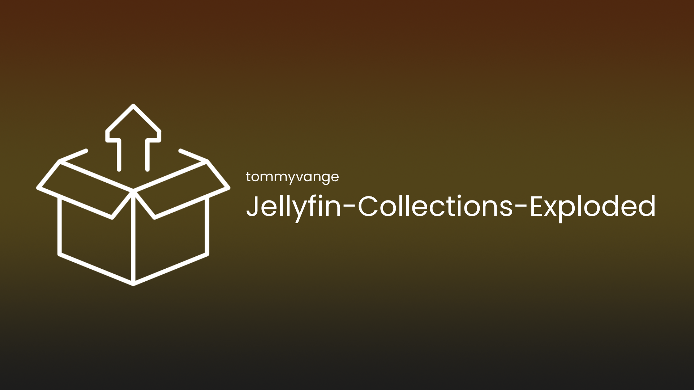

# Jellyfin Collections Exploded

[](https://github.com/tommyvange/Jellyfin-Collections-Exploded/actions/workflows/build.yml)
[](https://github.com/tommyvange/Jellyfin-Collections-Exploded/stargazers)
[](https://github.com/tommyvange/Jellyfin-Collections-Exploded/releases/latest)
[](LICENSE)



Give every collection its own horizontal row on a media item's detail page. Each heading opens the collection, and its cards show the collection's contents in your chosen order.

A movie belonging to three collections gets three rows in place of the combined Collections section. Each row defaults to **20 items, sorted by year, oldest first**. The item limit applies to each row independently.

## Requirements

- **Jellyfin 12.0 or newer**, using .NET 10.
- **File Transformation 3.x**, built for your Jellyfin version.
- The **server-hosted Jellyfin Web client**, in either Modern or Legacy layout.

Native apps and separately hosted web clients render their own interfaces and do not use this plugin's web transformations.

## Install

1. Install **File Transformation 3.x** for your Jellyfin version. Add [IAmParadox27's plugin repository](https://www.iamparadox.dev/jellyfin/plugins/manifest.json) in **Dashboard → Plugins → Repositories**, install **File Transformation**, and restart Jellyfin.
2. Add **Collections Exploded** as a plugin repository using:

   ```text
   https://raw.githubusercontent.com/tommyvange/Jellyfin-Collections-Exploded/manifest/manifest.json
   ```

3. Install **Collections Exploded** from the catalog, restart Jellyfin, and hard-refresh the web client.
4. Open **Dashboard → Plugins → Collections Exploded**, choose the item limit and sorting, and save. Reopen or refresh the media detail page to apply changes. Settings apply to all users.

File Transformation must be installed separately; Jellyfin does not install it automatically.

For manual installation, download the ZIP from [GitHub Releases](https://github.com/tommyvange/Jellyfin-Collections-Exploded/releases), stop Jellyfin, and extract all ZIP contents directly into `plugins/Collections Exploded_<version>/`. The DLL, `meta.json`, and plugin image must be at that directory's root. In the official Docker image, the plugins directory is normally `/config/plugins/`. Preserve the separate plugin configuration when upgrading, then restart Jellyfin and refresh the web client.

To disable the plugin, clear **Enable Collections Exploded** and reopen the media page. To remove it, uninstall through the dashboard or stop Jellyfin and remove its plugin directory.

## Settings and behavior

| Setting | Default | Choices |
| --- | --- | --- |
| Enabled | On | On or off |
| Maximum items per collection | 20 | Whole number from 1 to 100 |
| Sort collection contents | Year: oldest first | Year, title, date added, or release date, in either direction |

Year, date added, and release date use ascending title order as a secondary sort. The selected sort and limit are applied together, so each row contains the first items in that order. **Date added** means the item's library date. Unknown years follow Jellyfin's native sorting rules.

- Rows follow Jellyfin's alphabetical collection order. Collections with identical names stay separate.
- The current item can appear in its normal sorted position. Shared media can appear in several rows.
- Membership follows direct collection links. Episodes do not inherit their series' collections, and nested collections and series are not expanded.
- Requests use the signed-in viewer's API client and respect library and parental-access restrictions. Only administrators can change the settings.
- Cards use Jellyfin's native renderer and the same options as More Like This. Artwork, focus, play overlays, menus, and sizing follow Jellyfin and your theme.

## Loading and recovery

The native Collections section stays available until all collection memberships have loaded and the replacement headings are ready. Settings or discovery failures restore the native section. Unsupported web bundles or an unavailable native card renderer also keep the original section.

Each collection keeps its linked heading while loading, when empty, or when a content request fails. Failed previews show a **Retry** button. Up to four collection-content requests run at once, including retries, and rows stay in their original order as requests finish.

Navigation, cached pages, version changes, and authentication changes invalidate earlier work. Queued requests are canceled and late responses are ignored. Requests already in progress keep their queue slots until they finish. Settings are read on every detail-page activation, and there is no persistent media cache.

If the rows do not appear, check that both plugins are loaded and File Transformation matches the server version. Use the server's `/web/` client and clear cached web assets. Restart Jellyfin after replacing its web assets so the plugin can discover the supported detail-page files again.

## Build and test

Requires **.NET 10 SDK**, **Node.js 20+**, and `zip`/`unzip`. There are no npm dependencies to install.

```sh
npm test
npm run test:server
npm run build
npm run package
```

The package command builds the plugin in Release mode and writes the ZIP and SHA-256 checksum to `artifacts/`. It targets the minimum Jellyfin version in `release/config.json`, currently **12.0.0**. Set `DOTNET=/absolute/path/to/dotnet` if the SDK is not on your PATH.

The DLL embeds the client script, stylesheet, and settings page. Jellyfin supplies the server assemblies, so there is no separate frontend build or web deployment.

Tests cover collection loading, paging, sorting, request permissions, retries, queue limits, stale responses, server configuration, File Transformation registration, and release tooling.

To check the official production web assets, also install `ar` and `tar`, then run:

```sh
FIXTURE_DIR=.research/fixtures/12.0.0
bash scripts/fetch-web-fixtures.sh 12.0.0 "$FIXTURE_DIR"
node scripts/verify-web.mjs "$FIXTURE_DIR"
dotnet run --project tests/Server -- "$FIXTURE_DIR"
node scripts/verify-native-bridge.mjs "$FIXTURE_DIR"
```

Replace `12.0.0` with `latest` in both the directory and downloader arguments to check the latest stable release. The downloader verifies the official package's SHA-256. Compatibility checks exercise the patched detail module, native card rendering, navigation, and component lifecycle.

GitHub Actions checks the minimum supported version and the latest stable Jellyfin release, compiles against the latest server API, and repeats the checks weekly. Before releasing, also test a running server with a restricted viewer, both layouts, mobile and keyboard navigation, a reverse-proxy base path, and cached web assets.

## Releases and deployment

Update the four-part version in `Directory.Build.props`, the three-part version in `package.json`, and the release notes in `release/notes.md`. Commit and push to `main`, wait for **Build and test** to pass, then push a matching version tag, such as `v1.0.3.0`.

GitHub Actions runs the tests and compatibility checks, publishes the ZIP and SHA-256 checksum to GitHub Releases, and updates the Jellyfin catalog on the `manifest` branch. The release package targets the minimum supported Jellyfin version. The catalog retains earlier versions and includes Jellyfin's required MD5 checksum of the published ZIP.

Publishing uses GitHub Actions' built-in token. See [the release guide](docs/releasing.md) for versioning, publication retries, and catalog recovery.

## License

Licensed under the [GNU General Public License v3.0](LICENSE).
